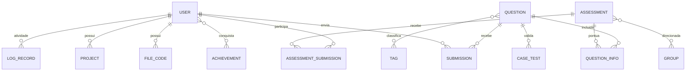

# Arquitetura — sendit

## Visão geral

O SendIT é uma plataforma web de desafios de programação e avaliações. A solução combina um monólito Django (site, domínio principal e administração) com um serviço Node.js/Hono que provisiona workspaces de IDE em containers Docker. PostgreSQL armazena dados de negócio; Redis sustenta cache e filas RQ. MinIO/S3 armazena mídia. 🟢

## Contexto C4

O sistema é usado por estudantes para resolver questões, participar de avaliações e editar projetos; administradores/staff mantêm questões, usuários, grupos e avaliações. Integra-se a PostgreSQL, Redis, armazenamento S3 compatível, Docker Engine e SMTP. Para detalhes do contexto e relações, veja [c4-context.md](c4-context.md). 🟢

## Principais containers e responsabilidades

| Container | Tecnologia | Responsabilidade |
|---|---|---|
| Web SendIT | Django 6, Python, Gunicorn | Login, questões, submissões, avaliações, editor web, projetos e administração |
| Worker | Django RQ / Python | Execução assíncrona das submissões de questões e do editor |
| Scheduler | Django management command + rq-scheduler | Agendamento de tarefas, incluindo rotina de ranking semanal |
| Projects API | Node.js, Hono, WebSocket, Dockerode | Criação de ambientes de IDE, operações de filesystem e proxy WebSocket |
| VM de IDE | Imagem Docker `sendit-vm` | Workspace interativo do usuário |
| PostgreSQL | PostgreSQL | Persistência dos modelos Django |
| Redis | Redis | Cache e filas RQ |
| MinIO | API compatível com S3 | Armazenamento local de mídia e arquivos |
| Mailpit / SMTP externo | SMTP | Captura de e-mail local ou entrega configurada |

O desenvolvimento usa Docker Compose para subir os serviços; em produção, `Procfile` descreve web, worker, scheduler e release. 🟢

## Módulos de domínio

- `core`: usuários/perfis, questões, casos de teste, submissões, ranking e conquistas.
- `evaluation`: avaliações por período e pontuação por questões resolvidas na janela.
- `editor`: runners avulsos e arquivos de código.
- `projects`: projetos pessoais e payloads de workspace.
- `statistics`: atividade, métricas SQL e views de ranking.
- `projects-api`: ambientes de IDE, filesystem, execução interativa e WebSockets.

## Integrações e fluxos

1. Navegador → Django: HTTP para páginas e submissões; autenticação por sessão Django.
2. Django → Redis/RQ → worker: enfileiramento de execução por UUID; worker atualiza `Submission` ou `Runner` em PostgreSQL.
3. Worker → Docker Engine: inicia container efêmero por caso, executa compilação e código e remove o container.
4. Navegador/IDE → Projects API: HTTP com cookie assinado e WebSocket para operações do workspace; API fala com Docker Engine pelo socket.
5. Projects API → filesystem host/VM: bind mount do workspace e notificações de árvore de arquivos via WebSocket.
6. Django → PostgreSQL, Redis e S3/MinIO: persistência, cache/fila e mídia.
7. Django → servidor SMTP: e-mail de sistema.

## Modelo de dados — visão resumida

O modelo transacional completo tem mais de cinco entidades; neste nível essencial fica representado por relações centrais, e os atributos estão descritos em [code-analysis.md](code-analysis.md). 🟢

## Dívidas e pontos arquiteturais a validar

- 🔴 Autorização por proprietário é inconsistente em views de avaliação/editor e no endpoint de estado de submissão; WebSocket não evidencia autenticação vinculada à sessão/projeto.
- 🟡 `projects-api` guarda estado de containers e sockets em Maps de processo; reinícios perdem o mapeamento, embora os containers tenham ciclo de vida Docker.
- 🟢 SQL de ranking e estatísticas depende de recursos PostgreSQL e está duplicado entre `core/domain.py`, `core/models.py` e `statistics/models.py`.
- 🟢 A execução segura depende das capacidades reais do Docker Engine e do host que monta seu socket.
- 🟡 Testes Django existem em cinco arquivos de app; o script de teste do Node está declarado, mas nenhum `*.test.js` apareceu no inventário.
- 🔴 Não há especificação OpenAPI ou contrato versionado documentando a API e o protocolo WebSocket.

## Confiança

Containers e fluxos descritos foram encontrados nos arquivos de configuração e implementação. A topologia de produção pode diferir do Compose/Procfile e precisa de confirmação operacional.
	