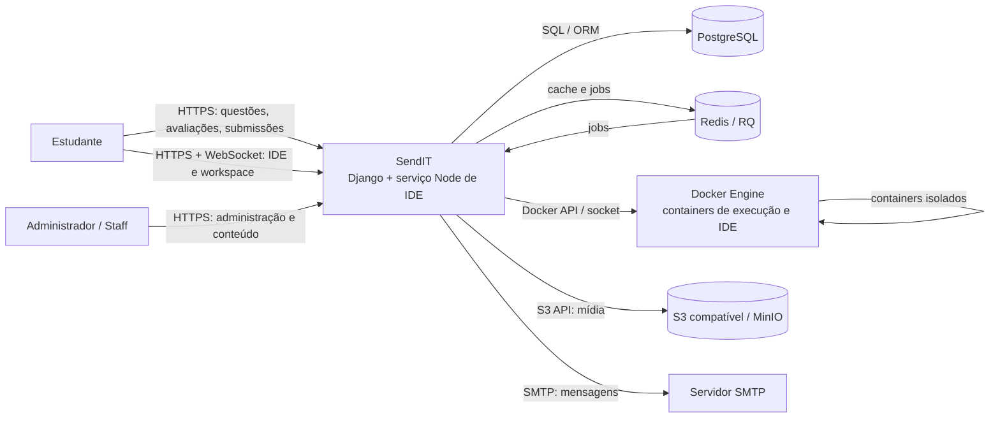

# C4 — Contexto do SendIT

## Atores

- **Estudante:** consulta desafios, envia código, participa de avaliações e usa a IDE.
- **Administrador/Staff:** administra conteúdo e usuários; staff pode consultar submissões de outros usuários.

## Sistemas externos e protocolos

| Sistema | Relação | Protocolo/dados |
|---|---|---|
| PostgreSQL | Persistência de modelos e views SQL | PostgreSQL/ORM |
| Redis | Cache, filas e scheduler | Redis/RQ |
| Docker Engine | Execução isolada e provisionamento da IDE | Docker API via socket Unix |
| S3/MinIO | Mídia e badges | API S3 |
| SMTP | Envio de e-mail | SMTP |

🟢 As integrações estão configuradas em `SendIT/settings.py`, `docker-compose.yml` e `projects-api/api/`. O diagrama mostra relações lógicas; produção pode usar hosts/serviços diferentes.
