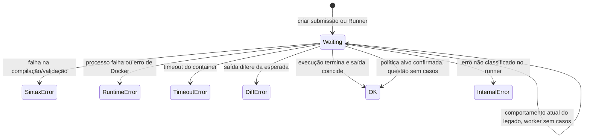
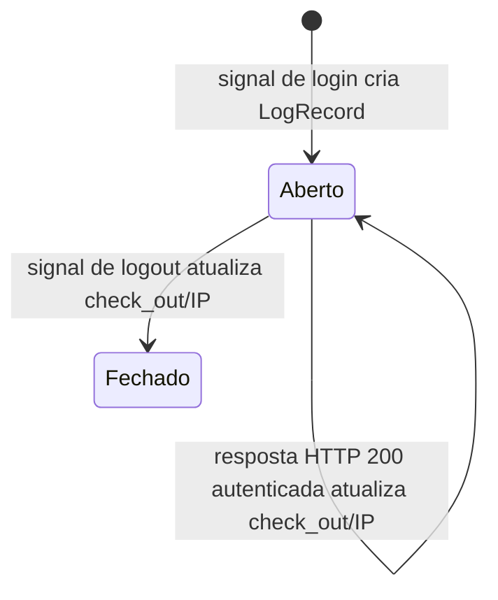

# Máquinas de estado

## Submissão (`Submission` e `Runner`)

Valores declarados em `core.models.Submission.STATUS_CHOICES` e reutilizados por `editor.Runner`: `Waiting`, `SintaxError`, `RuntimeError`, `TimeoutError`, `DiffError`, `OK`. O worker também pode persistir `InternalError`, retornado por `SubmissionRunner.run`, embora esse valor não esteja declarado nas choices. 🟢

O código não implementa transições entre estados terminais. Cada worker executa os casos sequencialmente e para ao primeiro resultado que não seja `OK`; portanto múltiplas falhas não são agregadas. O campo status não é protegido por uma máquina de estados formal e pode ser sobrescrito por novas execuções. 🟢

🟢 **Contrato alvo confirmado pelo usuário:** submissão de questão sem casos de teste termina em `OK`. O comportamento atual do legado diverge e permanece indicado acima para orientar a implementação.

## Atividade (`LogRecord`)

O estado é inferido pela presença de `check_out`; não existe campo explícito de status. O middleware atualiza o registro mais recente em cada resposta elegível, inclusive antes do logout. 🟢

## Avaliação

Não há campo de estado persistido em `Assessment` ou `AssessmentSubmission`. A disponibilidade é derivada do horário corrente com limites estritos: início e fim exatos retornam indisponível. O início da participação cria ou recupera o registro e não chama `is_available()` nessa view. 🟢

🟢 **Contrato alvo confirmado pelo usuário:** início e consulta de participação só são permitidos na janela ativa, e o acesso é restrito ao aluno dono ou a staff autorizado. O legado atual não impõe todas essas verificações.
